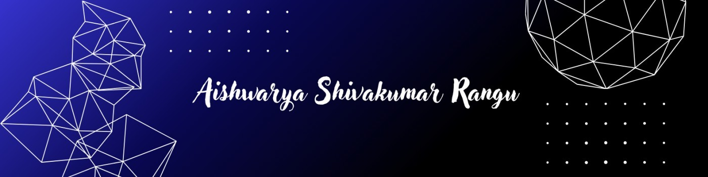

  

  

<h1 align="center">Hi 👋, I'm Aishwarya Rangu</h1>
<h3 align="center">Full Stack Developer |  Android Developer 🚀</h3>

---

### 👩‍💻 About Me
- 🎓 CSE (Data Science) Student  
- 💻 Passionate **Full Stack & Android Developer**  
- 📱 Love building clean, user-friendly applications  
- 🎮 Have basic experience in game development  
- 🌱 Always learning and improving my development skills  

---

### 🛠️ Tech Stack

#### 🌐 Web Development

  

#### 📱 Android Development

  

#### 🎮 Game Development (Basic)

  

#### 🧰 Tools & Platforms

  

---

## 📊 GitHub Analytics

  

  

   

  

---

  ### 💙 Thanks for visiting!

  *Building, learning, and creating one commit at a time.*

---

### 🔗 Connect With Me
- 💼 LinkedIn: [Aishwarya Rangu](https://www.linkedin.com/in/aishwarya-rangu-579787286)

---

⭐ *Focused on building impactful web and mobile applications.*

<!--
**aishwarya-0409/aishwarya-0409** is a ✨ _special_ ✨ repository because its `README.md` (this file) appears on your GitHub profile.

Here are some ideas to get you started:

- 🔭 I’m currently working on ...
- 🌱 I’m currently learning ...
- 👯 I’m looking to collaborate on ...
- 🤔 I’m looking for help with ...
- 💬 Ask me about ...
- 📫 How to reach me: ...
- 😄 Pronouns: ...
- ⚡ Fun fact: ...
-->
